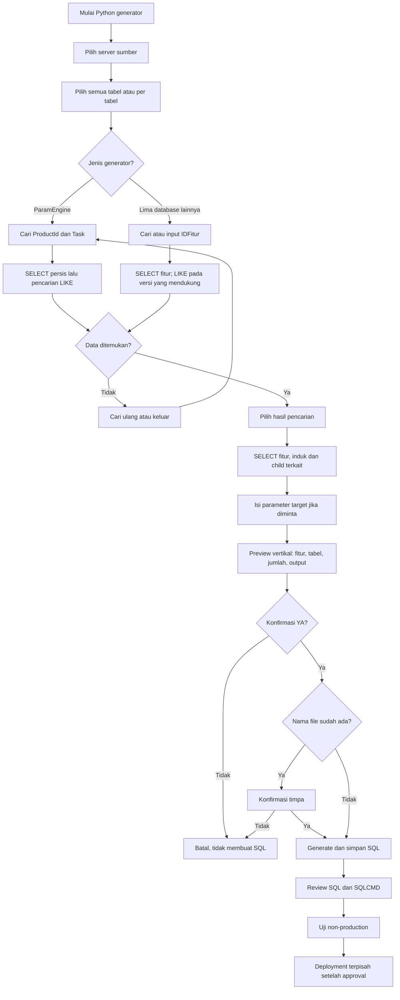

# HOW TO — GenerateScriptDeploy (6 Database)

**Panduan operasional, pencarian LIKE, preview vertikal, dan penjelasan Python**  
**Tanggal:** 28 Oktober 2026  
**Database:** `DataFlowParam`, `DataSourceDistributor`, `Enterprise4`, `OtomasiMCS`, `ParamEngine`, `RekonParam`

> **Ruang lingkup:** Disesuaikan dengan enam file generator Python yang tersedia. Generator membaca SQL Server sumber dengan query `SELECT` dan membuat file `.sql`; **tidak mengeksekusi deployment**. Pencarian `LIKE` dan preview vertikal tersedia pada lima generator terbaru. `Enterprise4` masih menggunakan pemilihan `IDFitur` langsung pada file yang diperiksa.

## 1. Tujuan dan prinsip kerja

GenerateScriptDeploy membuat SOP SQL untuk memindahkan konfigurasi terpilih dari database sumber ke target. Pengguna memilih server sumber, cakupan tabel, fitur/aktivitas yang ingin diekspor, dan parameter target bila diperlukan. File SQL disimpan untuk diperiksa, diuji, dan dieksekusi secara **terpisah** setelah persetujuan.

- **Read-only pada sumber:** generator melakukan `SELECT`; tidak mengubah database sumber.
- **Tidak melakukan deploy otomatis:** konfirmasi `YA` hanya membuat file `.sql`.
- **Dependency:** tabel induk/referensi ikut disertakan sesuai kebutuhan generator.
- **INSERT jika belum ada:** SQL umumnya menggunakan `IF NOT EXISTS`, bukan sinkronisasi `UPDATE`/`DELETE`.
- **Keamanan:** beberapa konfigurasi, misalnya FTP, dapat membawa informasi sensitif ke file output. Batasi akses ke hasil generate.

## 2. Persiapan dan struktur folder

Pastikan Python 3, driver SQL Server dan dependensi proyek, akses SELECT ke sumber, serta `db_config.py` dan `db_connection.py` tersedia.

```text
Synqra-1.0/
├── db_config.py
├── db_connection.py
└── generateScriptDeploy/
    ├── DataFlowParam-generateScriptDeploy.py
    ├── DataSourceDistributor-generateScriptDeploy.py
    ├── Enterprise4-generateScriptDeploy.py
    ├── GenerateScriptDeploy-OtomasiMCS.py
    ├── GenerateScriptDeploy-ParamEngine.py
    ├── RekonParam-generateScriptDeploy.py
    └── output/                         # dibuat saat menyimpan SQL
```

**Nama file mengikuti file Python yang benar-benar diperiksa.** Jika nama di folder lokal berbeda, gunakan nama aktualnya atau samakan dengan nama pada struktur di atas.

Jalankan dari root proyek:

```bash
python3 generateScriptDeploy/DataFlowParam-generateScriptDeploy.py
python3 generateScriptDeploy/DataSourceDistributor-generateScriptDeploy.py
python3 generateScriptDeploy/Enterprise4-generateScriptDeploy.py
python3 generateScriptDeploy/GenerateScriptDeploy-OtomasiMCS.py
python3 generateScriptDeploy/GenerateScriptDeploy-ParamEngine.py
python3 generateScriptDeploy/RekonParam-generateScriptDeploy.py
```

**Pilihan koneksi:** DataFlowParam, DataSourceDistributor, dan OtomasiMCS memakai `SERVERS['2']` (Server 205) dan `SERVERS['3']` (Localhost); ParamEngine memakai pilihan Server 102 dan Localhost; RekonParam memiliki menu pemilihan server pada script; Enterprise4 memiliki pemilihan server tersendiri. Semua memanggil `connect_sqlserver` dari `db_connection.py`. Alamat dan port aktual mengikuti konfigurasi proyek, bukan nilai contoh di dokumen.

## 3. Flow operasional terbaru



**Catatan:** pada `Enterprise4`, pemilihan fitur pada versi saat ini dilakukan dengan input IDFitur, bukan menu LIKE. Pada `RekonParam`, pengguna dapat memilih lebih dari satu fitur. Pada `ParamEngine`, kunci pencarian adalah pasangan `ProductId` dan `Task`.

### Urutan penggunaan terminal

1. Buka terminal pada root `Synqra-1.0`, lalu jalankan generator database yang sesuai.
2. Pilih **Server 205 / Server 102 / Localhost** sesuai menu dan database.
3. Pilih **Semua tabel** atau satu tabel; jika memilih child, induk yang diperlukan tetap disertakan.
4. Masukkan kata kunci pencarian. Pilih nomor hasil yang sesuai. Gunakan `0` untuk mencari ulang/kembali sesuai petunjuk menu, atau `q` untuk keluar jika tersedia.
5. Untuk RekonParam, ulangi pemilihan sampai semua fitur yang diperlukan terkumpul. Untuk ParamEngine, tentukan pasangan `ProductId`–`Task`.
6. Masukkan IPServer dan DBUser **target** bila diminta. Jangan memasukkan password produksi ke input kata kunci.
7. Periksa **preview vertikal**, termasuk server, fitur, tabel, jumlah baris, nama file, dan folder output.
8. Jawab `YA` untuk membuat SQL atau `TIDAK` untuk membatalkan. Jika nama file sudah ada, tanggapi konfirmasi overwrite.
9. Review file di `generateScriptDeploy/output/`, periksa dependensi dan variabel SQLCMD, lakukan uji non-production, kemudian deploy melalui proses terpisah.

## 4. Perbandingan enam generator

| Aspek | DataFlowParam | DataSourceDistributor | Enterprise4 | OtomasiMCS | ParamEngine | RekonParam |
|---|---|---|---|---|---|---|
| Kunci pencarian | IDFitur, FiturName, DBSource, DBDestination, Modul/SubModul/Entity | IDFitur, DBName, IPServer | IDFitur langsung | IDFitur, Modul, Name, FiturID | **ProductId + Task** | IDFitur, DBName, Modul/SubModul/Entity |
| Pencarian LIKE | Ya | Ya | **Belum** pada file yang diperiksa | Ya | Ya | Ya |
| Tabel utama | ParamServer, ParamFitur, ParamFiturCekLogActivity | ParamFitur + 17 utama + 8 child | ParamFitur + 30 mapping + endpoint terkait | ParamFitur + 2 child | 12 tabel konfigurasi | ParamFitur + 3 child |
| Semua/per tabel | Ya | Ya | Ya | Ya | Ya | Ya |
| Multi-fitur | Tidak | Tidak | Tidak | Tidak | Tidak; satu pasangan ProductId–Task | **Ya** |
| Input target | IPServer + DBUser untuk 3 role | IPServer + DBUser | IPServer + DBUser | IPServer + DBUser | Tidak diminta | Tidak diminta |
| SQLCMD password | `PasswordSource`, `PasswordDestination`, `PasswordLogActivity` | `PasswordProd` | `PasswordProduction` | `PasswordProduction` | Tidak ada placeholder password produksi khusus pada generator ini | `Password1` s.d. `PasswordN` |
| SQL dijalankan otomatis | Tidak | Tidak | Tidak | Tidak | Tidak | Tidak |

**Perbedaan penting:** jumlah referensi `ParamServer` di DataFlowParam adalah **3 role**, tetapi tidak selalu berarti 3 baris server unik. RekonParam dapat menggabungkan banyak `IDFitur` ke satu SQL. ParamEngine tidak memerlukan IDFitur untuk pemilihan data.

## 5. HOW TO DataFlowParam

**Jalankan:** `python3 generateScriptDeploy/DataFlowParam-generateScriptDeploy.py`

**Tabel dan dependency:** `ParamServer`, `ParamFitur`, `ParamFiturCekLogActivity`. Pilihan `ParamServer` hanya membuat server yang diperlukan. Pilihan `ParamFitur` menyertakan `ParamServer`. Pilihan `ParamFiturCekLogActivity` menyertakan `ParamServer` dan `ParamFitur`.

**Pencarian:** `IDFitur`, `FiturName`, `DBSource`, `DBDestination`, `TableDestination`, `LogActivityModul`, `LogActivitySubModul`, `LogActivityEntity`. Kata kunci teks menggunakan LIKE sebagian nama. Jika tidak ada hasil, gunakan kata yang lebih pendek.

**Parameter target:** masing-masing role **Source**, **Destination**, dan **LogActivity** meminta `IPServer` dan `DBUser`. Ketiganya dapat menunjuk server yang sama; generator tetap melakukan resolusi ID target per role.

**Contoh preview:**

```text
==============================================================
  PREVIEW KONFIGURASI DEPLOYMENT
==============================================================
  Server sumber          : Server 205
  Database sumber        : DataFlowParam
  Pilihan tabel          : Semua
  IDFitur sumber         : 1234
  FiturName              : REKON SETTLEMENT
  DBSource               : SourceDB
  DBDestination          : TargetDB

==============================================================
  KONFIGURASI SERVER PRODUKSI
==============================================================
  SOURCE
    IPServer target      : <IP sumber produksi>
    DBUser target        : <user>

  DESTINATION
    IPServer target      : <IP tujuan produksi>
    DBUser target        : <user>

  LOGACTIVITY
    IPServer target      : <IP log produksi>
    DBUser target        : <user>

==============================================================
  RINCIAN DATA YANG AKAN DI-GENERATE
==============================================================
  ParamServer            : 3 referensi role
  ParamFitur             : 1 baris
  ParamFiturCekLogActivity : 2 baris

  Lanjut buat file SQL? [YA/TIDAK]:
```

*Angka dan nama pada contoh hanyalah ilustrasi.*

**Fungsi Python:** `search_feature()` mencari fitur, `load_source_data()` mengambil fitur/server/child, `prompt_role()` meminta target, `render_server()` membuat INSERT server dan lookup `IdServer`, `render_feature()` meremap FK server, `render_children()` mengeluarkan child, `generate()` menyatukan transaksi, `build_output_path()` menyusun nama file.

**SQLCMD:** `PasswordSource`, `PasswordDestination`, `PasswordLogActivity`.

## 6. HOW TO DataSourceDistributor

**Jalankan:** `python3 generateScriptDeploy/DataSourceDistributor-generateScriptDeploy.py`

**Cakupan:** `ParamFitur` dan **25 tabel activity** (17 utama + 8 child).

**Tabel utama (17):** `ParamDDHIST`, `ParamWay4CardPostingData`, `ParamCPD13055`, `ParamDDTRN`, `ParamTLLOG`, `ParamTLLOG24`, `ParamPSW`, `ParamESB`, `ParamFTP`, `ParamParseFile`, `ParamGenerateFile`, `ParamZipFile`, `ParamInqCardno`, `ParamTLJBH0`, `ParamBRD330`, `ParamESBRevamp`, `ParamEMAIL`.

**Tabel child (8):** `ParamFTPCekLogActivity`, `ParamParseFileCekLogActivity`, `ParamParseFileMappingColumn`, `ParamGenerateFileCekLogActivity`, `ParamZipFileCekLogActivity`, `ParamInqCardnoCekLogActivity`, `ParamEMAILCekLogActivity`, `ParamEMAILAttachmentFile`.

**Pencarian:** `IDFitur`, `DBName`, `IPServer` dengan LIKE untuk teks. Hasil ditampilkan per kartu vertikal berisi IDFitur, IPServer sumber, dan DBName. Pilih nomor, `0` untuk cari ulang, atau `q` untuk keluar. Setelah fitur dipilih, isi `IPServer` dan `DBUser` target.

**Contoh:** pilih `ParamFTPCekLogActivity`. Generator mengambil `ParamFTP` sebagai induk, lalu membangun INSERT child dengan FK yang mengarah ke ID parent **target**, bukan ID sumber.

**Fungsi Python:** `BASE` menyimpan kolom tabel utama; `CHILD` menyimpan relasi parent/FK/PK; `search_feature()` melakukan pencarian; `select()`/`get()` membaca data; `generate()` membangun INSERT `ParamFitur`, parent, child; `safe()` membuat nama file aman.

**SQLCMD:** `PasswordProd`. **Peringatan:** konfigurasi FTP, ZIP, email, atau file dapat mengandung informasi sensitif yang tertulis di output SQL.

## 7. HOW TO Enterprise4

**Jalankan:** `python3 generateScriptDeploy/Enterprise4-generateScriptDeploy.py`

**Cakupan:** `ParamFitur`, **30 tabel mapping/condition/dictionary**, serta endpoint terkait yang dibutuhkan. Endpoint: `EndpoinInq`, `EndpoinList`, `EndpoinMCS`, `EndpoinMatchManual`, `EndpoinOpenMatchManual`, `EndpoinOpenMatchSystem`, `EndpoinDIO`.

**Alur:** pilih server, pilih semua/per tabel, **masukkan IDFitur secara langsung**, isi IPServer dan DBUser production, lalu review preview dan konfirmasi. **Jangan mengharapkan menu LIKE/preview vertikal terbaru pada Enterprise4** sebelum script Enterprise4 juga diperbarui.

**Contoh:** memilih `MappingResultInq` menyertakan konfigurasi `ParamFitur` dan endpoint `EndpoinInq` yang diperlukan menurut mapping.

**Fungsi Python:** `TABLES` memuat mapping, `ENDPOINTS` menentukan dependensi, `KEYS` mendefinisikan kunci pencocokan, `metadata()` membaca struktur SQL Server, `endpoint_dependencies()` menentukan endpoint terkait, `emit_table()` menyusun SQL INSERT, `generate()` membangun transaksi.

**SQLCMD:** `PasswordProduction`. **Perhatian:** audit identity/PK/FK target sebelum deploy karena tabel tertentu dapat mempertahankan ID sumber.

## 8. HOW TO OtomasiMCS

**Jalankan:** `python3 generateScriptDeploy/GenerateScriptDeploy-OtomasiMCS.py`

**Cakupan:** `ParamFitur`, `ParamFiturCekLogActivity`, `ParamQryPembukuanRekonESB`.

**Pencarian:** masukkan sebagian `IDFitur`, `Modul`, `Name`, atau `FiturID`. Hasil LIKE ditampilkan vertikal. Pilih nomor hasil, `0` untuk cari ulang, `q` untuk keluar. Jika tidak ditemukan, cari dengan kata lebih pendek.

**Alur:** pilih Server 205/Localhost → tabel → cari fitur → pilih hasil → isi IPServer/DBUser production → preview vertikal → konfirmasi → file SQL.

**Contoh:** pilih `ParamQryPembukuanRekonESB`; SQL tetap menyertakan `ParamFitur` sebagai induk untuk resolusi IDFitur tujuan.

**Fungsi Python:** `FEATURE_COLS`/`PROD_COLS` mendefinisikan kolom fitur, `CHILDREN` menentukan child, `find_features()` melakukan LIKE, `choose_feature()` memilih hasil, `metadata()`/`validate()` memvalidasi skema, `render_children()` menghasilkan INSERT idempoten, `generate()` menyusun SQL transaksi, `filename_for()` membuat nama output.

**Kunci natural ParamFitur:** `Modul`, `Name`, `FiturID`. **SQLCMD:** `PasswordProduction`.

## 9. HOW TO ParamEngine

**Jalankan:** `python3 generateScriptDeploy/GenerateScriptDeploy-ParamEngine.py`

**Server sumber:** **Server 102** atau Localhost. **Database:** `ParamEngine`.

**Dua belas tabel:** `ParamCriteria`, `ParamDataFlow`, `ParamGetESB`, `ParamGetMasterBRI`, `ParamGetDDHIST`, `ParamGetDDMAST`, `ParamGenerateFile`, `ParamFTP`, `ParamSPExecutor`, `ParamParseFile`, `ParamParseFileMappingColumn`, `ParamRecon`.

**Perbedaan utama:** tidak mencari berdasarkan IDFitur. Pengguna memasukkan **ProductId** dan **Task**. Generator mencoba pasangan persis; jika tidak ditemukan, mencari pasangan yang mirip menggunakan SQL LIKE pada tabel yang dipilih. Pilih salah satu pasangan yang muncul, atau cari ulang.

**Contoh terminal:**

```text
=== CARI PRODUCT & TASK ===
ProductId sumber / kata kunci: plnicon
Task sumber / kata kunci: plnicon

=== HASIL PENCARIAN MIRIP ===
  [1]
    ProductId : PLNICON
    Task      : PLNICON-NONTAGLIS

  [2]
    ProductId : PLNICON
    Task      : PLNICON-POSTPAID

  [3]
    ProductId : PLNICON
    Task      : PLNICON-PREPAID

  0. Cari ulang
  q. Keluar
  Pilih nomor [1-3], 0, atau q: 1
```

**Preview:** server, database, tabel, ProductId, Task, jumlah data tiap tabel, total, nama file, dan folder output. Data yang dipakai untuk SQL adalah pasangan `ProductId`–`Task` **persis setelah dipilih**, bukan semua baris yang cocok LIKE.

**Fungsi Python:** `select_server()`/`select_tables()` memilih sumber dan scope; `search_candidates()` mencari pasangan mirip; `choose_product_task()` memilih pasangan; `metadata()` membaca kolom tabel; `read_source()` membaca baris terpilih; `build_sql()` membuat SQL INSERT jika belum ada; `safe_name()` menyusun nama file.

**SQLCMD:** generator ini tidak meminta password target melalui placeholder SQLCMD khusus. **Periksa kolom konfigurasi yang diekspor**, terutama FTP, sebelum membagikan SQL.

## 10. HOW TO RekonParam

**Jalankan:** `python3 generateScriptDeploy/RekonParam-generateScriptDeploy.py`

**Cakupan:** `ParamFitur`, `ParamFiturCekLogActivity`, `ParamSPExecutor`, `ParamJoin`.

**Pencarian:** `IDFitur`, `DBName`, `LogActivityModul`, `LogActivitySubModul`, `LogActivityEntity`. Pengguna bisa memilih **beberapa hasil fitur**; hasil ditampilkan vertikal per IDFitur. Setelah fitur pertama dipilih, tambahkan fitur lain sesuai menu sampai daftar selesai.

**Contoh preview multi-IDFitur:**

```text
==============================================================
  PREVIEW KONFIGURASI DEPLOYMENT
==============================================================
  Database                : RekonParam
  Pilihan tabel           : Semua tabel
  Jumlah fitur            : 2

==============================================================
  RINCIAN FITUR DAN DATA
==============================================================
  FITUR 1
  IDFitur                 : 101
  Modul                   : REKON
  SubModul                : SETTLEMENT
  Entity                  : REKON-A
  ParamFitur (induk)      : 1 baris
    ParamSPExecutor
      Jumlah data         : 2 baris

  FITUR 2
  IDFitur                 : 102
  Modul                   : REKON
  SubModul                : SETTLEMENT
  Entity                  : REKON-B
  ParamFitur (induk)      : 1 baris
    ParamSPExecutor
      Jumlah data         : 1 baris

  TOTAL DATA              : 5 baris
```

*Contoh hanya ilustrasi; tabel child dan jumlah baris mengikuti scope dan data aktual.*

**Fungsi Python:** `find_features()` dan `choose_features()` menangani pencarian dan multi-pilihan, `parse_ids()` memvalidasi daftar ID, `get_columns()` mengabaikan identity/computed/rowversion, `read_rows()` membaca data, `emit_feature()` membuat parent dan lookup IDFitur target, `emit_children()` membuat child, `generate()` menyatukan beberapa activity dalam transaksi.

**SQLCMD:** `Password1`, `Password2`, ... sesuai **urutan fitur pada preview**, bukan nomor IDFitur. Tidak ada input IPServer/DBUser target; review konfigurasi yang dibawa dari sumber.

## 11. Format nama file dan lokasi output

Semua file `.sql` disimpan di `generateScriptDeploy/output/` (relatif terhadap folder script), misalnya:

```text
SOP DataFlowParam_20261028.sql
SOP DataSourceDistributor_20261028.sql
SOP Enterprise4_20261028.sql
SOP OtomasiMCS_20261028.sql
SOP ParamEngine_20261028.sql
SOP RekonParam_20261028.sql
```

Contoh per tabel:

```text
SOP DataFlowParam_ParamFitur_REKON_SETTLEMENT_20261028.sql
SOP DataSourceDistributor_ParamFTP_NamaModul_20261028.sql
SOP Enterprise4_MappingResultInq_NamaModul_20261028.sql
SOP OtomasiMCS_ParamQryPembukuanRekonESB_MODUL_NAME_20261028.sql
SOP ParamEngine_ParamGetESB_PLNICON_PLNICON-NONTAGLIS_20261028.sql
SOP RekonParam_ParamJoin_NamaModul_20261028.sql
```

Nama modul/fitur dibersihkan agar aman sebagai nama file. **Nama file hanya menggunakan tanggal**, bukan jam. Bila generate ulang dengan nama yang sama, file lama bisa tertimpa; gunakan konfirmasi overwrite dan arsipkan hasil sebelumnya jika diperlukan.

## 12. Penjelasan fungsi Python bersama

| Komponen | Kegunaan |
|---|---|
| `Path(__file__).resolve().parent.parent` | Menentukan root proyek untuk import koneksi |
| `SERVERS` / `choose_server()` | Mengambil konfigurasi server sumber |
| `connect_sqlserver(config, DATABASE)` | Membuka koneksi SQL Server sumber |
| `cursor.execute(..., params)` | Membaca data dengan query berparameter |
| `search_feature()` / `find_features()` / `search_candidates()` | Pencarian IDFitur atau ProductId–Task menggunakan LIKE |
| `metadata()` / `get_columns()` | Memeriksa tabel dan kolom yang didukung |
| `literal()` / `lit()` | Mengubah nilai Python menjadi literal SQL (`NULL`, teks, angka, tanggal, bytes) |
| `ident()` / `q()` | Membungkus nama tabel/kolom dengan identifier SQL Server |
| `predicate()` / `condition()` | Menyusun kondisi pencocokan data target |
| `generate()` / `build_sql()` | Menyusun INSERT, relasi induk–child, dan transaksi |
| `path.write_text(...)` | Menulis SQL ke file lokal; **bukan mengeksekusi SQL** |
| `path.chmod(0o600)` | Berusaha membatasi akses file di OS yang mendukung |

**Contoh konsep INSERT jika belum ada:**

```sql
IF NOT EXISTS (
    SELECT 1
    FROM dbo.[ParamFitur]
    WHERE [Modul] = N'MODUL_A'
      AND [Name] = N'FITUR_A'
      AND [FiturID] = 100
)
BEGIN
    -- INSERT konfigurasi baru
END;
```

`IF NOT EXISTS` tidak memperbarui baris lama. Jika konfigurasi target sudah ada tetapi berbeda, siapkan prosedur UPDATE terpisah setelah review. Kunci pencocokan dan constraint target perlu diperiksa.

**Contoh transaksi:**

```sql
SET XACT_ABORT ON;
BEGIN TRY
    BEGIN TRANSACTION;
    -- INSERT parent
    -- INSERT child
    COMMIT TRANSACTION;
END TRY
BEGIN CATCH
    IF XACT_STATE() <> 0 ROLLBACK TRANSACTION;
    THROW;
END CATCH;
```

## 13. SQLCMD dan keamanan password

| Database | Variabel SQLCMD |
|---|---|
| DataFlowParam | `$(PasswordSource)`, `$(PasswordDestination)`, `$(PasswordLogActivity)` |
| DataSourceDistributor | `$(PasswordProd)` |
| Enterprise4 | `$(PasswordProduction)` |
| OtomasiMCS | `$(PasswordProduction)` |
| ParamEngine | Tidak menggunakan placeholder password produksi khusus |
| RekonParam | `$(Password1)`, `$(Password2)`, ..., `$(PasswordN)` |

**SQLCMD adalah substitusi teks, bukan parameter terenkripsi.** Nilai password dengan apostrof atau karakter khusus perlu penanganan sesuai ekspresi SQL yang dihasilkan. Jangan menaruh secret dalam commit Git, log terminal, tangkapan layar, atau file yang dibagikan. Gunakan mekanisme secret resmi organisasi dan lakukan review terhadap pemanggilan `fnEncrypt`.

**SQLCMD Mode di SSMS tidak otomatis mengisi variabel.** Pastikan variabel tersedia dan sesuai sebelum eksekusi. ParamEngine tetap dapat memuat nilai sensitif dari kolom konfigurasi walaupun tidak menggunakan placeholder password khusus.

## 14. Checklist operasional

### Sebelum generate

- [ ] Server dan database sumber sesuai.
- [ ] Tabel atau scope sesuai kebutuhan.
- [ ] IDFitur atau pasangan ProductId–Task sudah diverifikasi.
- [ ] Jika RekonParam multi-fitur, daftar dan urutan fitur benar.
- [ ] Hak akses database sumber memadai untuk SELECT.

### Setelah preview, sebelum membuat SQL

- [ ] Server sumber dan target tidak tertukar.
- [ ] Nilai IPServer/DBUser target benar jika diminta.
- [ ] Rincian tabel, jumlah baris, dan dependensi masuk akal.
- [ ] Nama output dan risiko overwrite sudah diperiksa.
- [ ] Konfirmasi `YA` hanya diberikan setelah preview benar.

### Sebelum deployment terpisah

- [ ] Struktur tabel/kolom dan tipe data target cocok.
- [ ] Natural key, PK, identity, FK, dan relasi parent–child sudah diaudit.
- [ ] Placeholder SQLCMD dan penanganan secret benar.
- [ ] File SQL tidak mengandung kredensial yang tidak boleh dibagikan.
- [ ] SQL diuji di non-production.
- [ ] Backup/rollback plan dan approval deployment tersedia.

### Setelah deployment

- [ ] Jumlah data dan referensi parent–child tervalidasi.
- [ ] Tidak ada error/duplikasi yang tidak diinginkan.
- [ ] Konfigurasi berjalan sesuai kebutuhan.
- [ ] SOP dan bukti perubahan diarsipkan secara aman.

## 15. Troubleshooting

| Gejala | Penyebab umum | Tindakan |
|---|---|---|
| `ModuleNotFoundError: db_config` | Struktur folder tidak sesuai | Pastikan file generator di `generateScriptDeploy/` dan `db_config.py` di root |
| Koneksi SQL gagal | Host/port, VPN, driver, atau kredensial | Cek `SERVERS`, jaringan, dan driver |
| Hasil LIKE kosong | Kata kunci terlalu spesifik atau tabel/server salah | Coba kata lebih pendek; cek scope dan sumber |
| ProductId/Task tidak cocok | Pasangan persis tidak ada | Pilih hasil mirip atau ulangi pencarian |
| IDFitur tidak ditemukan | Fitur tidak ada pada server/database yang dipilih | Periksa sumber dengan SELECT manual |
| Tabel/kolom tidak ditemukan | Skema berbeda dengan definisi generator | Periksa `sys.tables` dan `sys.columns` |
| File sudah ada | Nama file menggunakan tanggal yang sama | Review dan pilih timpa atau arsipkan file lama |
| SQLCMD variable not defined | Password belum dipasok | Siapkan variabel melalui prosedur secret |
| PK/FK conflict | Benturan ID atau mapping dependency | Audit ID induk dan child di target |
| SQL tidak mengubah data existing | SQL menggunakan `IF NOT EXISTS` | Gunakan SOP UPDATE terpisah bila dibutuhkan |
| `q` atau `0` tidak bekerja di menu tertentu | Perilaku tiap script/menu berbeda | Ikuti instruksi yang tercetak pada prompt; `Ctrl+C` untuk membatalkan |

## 16. Batasan dan catatan implementasi

1. **Semua tabel** berarti tabel yang didukung generator untuk fitur/aktivitas terpilih, bukan seluruh isi database.
2. Preview dan pencarian LIKE berlaku untuk versi generator yang disebutkan; Enterprise4 masih menggunakan alur lama.
3. SQL hasil generate belum diuji otomatis terhadap database target; pengujian SQL Server harus dilakukan terpisah.
4. `IF NOT EXISTS` tidak otomatis menjamin keunikan jika kunci target tidak memiliki constraint yang memadai.
5. Tidak ada backup database production otomatis di enam generator ini.
6. Generator tidak melakukan `UPDATE` atau `DELETE` data target secara otomatis.
7. Preview DataFlowParam menghitung **referensi role**, bukan selalu jumlah record `ParamServer` yang unik.
8. Pembuatan SQL tidak sama dengan deployment; eksekusi harus melewati review dan approval.

---

**Ringkasan:** Pilih generator → server sumber → scope tabel → cari dan pilih fitur (atau ProductId–Task) → isi parameter target bila diminta → cek preview vertikal → konfirmasi `YA` → simpan SQL → review dependency dan SQLCMD → uji → deployment terkontrol.
