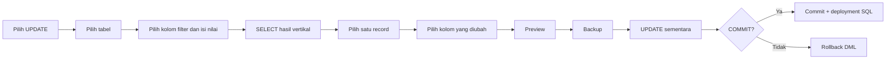

# PANDUAN OPERASIONAL — RekonEnterpriseAPI

**Wizard INSERT 15 tabel berurutan · UPDATE berbasis SELECT · backup per perubahan · deployment SQL**

> **Penting:** Gunakan Localhost (Testing) terlebih dahulu sebelum Server 205.

## 1. Gambaran alur

### Flow RekonEnterpriseAPI


**Aturan utama:** pilihan **INSERT** langsung membuka form; pilihan **existing** baru melakukan SELECT. **ParamFitur tidak menampilkan seluruh tabel** ketika dibuka. Semua hasil SELECT ditampilkan **vertikal, satu record per blok**.

## 2. Persiapan dan menjalankan

Dari root repository, pastikan tersedia `db_config.py`, `db_connection.py`, dan environment Python dengan driver SQL Server. Tempatkan file Python pada `activities/RekonEnterpriseAPI/python/RekonEnterpriseAPI.py`.

```bash
./.venv/bin/python activities/RekonEnterpriseAPI/python/RekonEnterpriseAPI.py
```

Menu koneksi yang muncul:

```text
=== REKONENTERPRISEAPI | INSERT BERURUTAN / UPDATE FILTER ===

Pilih koneksi SQL Server (khusus RekonEnterpriseAPI):
  1. Server 205 (172.18.135.205:1433)
  2. Localhost (Testing) (localhost:1433)
  0. Keluar
Pilih server [1/2/0]: 2

  [1] INSERT 15 tabel berurutan
  [2] UPDATE pilih tabel dan filter kolom
  [3] SELESAI
Operasi: 1
```

Koneksi memakai kredensial yang sudah tersimpan di `db_config.py`. Program memverifikasi database tujuan bernama `RekonEnterpriseAPI`.

## 3. INSERT — tahap 1/15: ParamFitur

```text
[1/15] PARAMFITUR (tidak menampilkan seluruh tabel)
  [1] INSERT ParamFitur baru
  [2] Cari / gunakan ParamFitur existing
  [3] SKIP tabel
  [4] Kembali ke menu utama
Tindakan: 1
```

### 3A. Jika pilih INSERT baru

- Program **langsung membuka form** `Name`, `IPServer`, `DBName`, `DBUser`, `DBPass`, `IsActive`, dan kolom editable lain sesuai metadata database.
- **Jangan isi `IDFitur`**: program tidak memintanya.
- Setelah form, pilih **Lanjut INSERT**, **Edit kolom tertentu**, **Ulangi seluruh input**, atau **Batalkan**.
- Setelah preview dan konfirmasi `Y`, program membuat backup, menjalankan INSERT sementara, lalu menunggu kata `COMMIT` **persis huruf besar**.
- Jika berhasil COMMIT, `IDFitur` hasil INSERT menjadi **produk aktif** untuk tabel anak.

```text
=== PREVIEW INPUT ===
Name     : ProdukBaru
DBName   : DatabaseBaru
DBPass   : [TERSEMBUNYI]

  [1] Lanjut INSERT
  [2] Edit kolom tertentu
  [3] Ulangi seluruh input
  [4] Batalkan
Tindakan: 1

Backup dan jalankan DML sementara? Ketik Y: Y
[BACKUP COMMITTED] dbo.ParamFitur_Backup_...
[IDFitur DIALOKASIKAN] ... (belum COMMIT)
[SEMENTARA] DML berhasil; transaksi BELUM COMMIT.
Ketik COMMIT untuk menyimpan; input lain = ROLLBACK: COMMIT
[COMMIT] Perubahan tersimpan.
[PRODUK AKTIF] IDFitur=...
```

**Mekanisme IDFitur:** jika kolom memakai `IDENTITY` atau DEFAULT, database menghasilkan ID. Jika tidak, kode menggunakan `MAX(IDFitur)+1` dengan application lock dan `TABLOCKX/HOLDLOCK` selama transaksi. **Pastikan metode ini sesuai aturan database**; bila ada sequence, trigger, atau prosedur resmi yang berbeda, sesuaikan sebelum dipakai di produksi.

### 3B. Jika pilih existing

Baru pada opsi ini program meminta kolom pencarian (`IDFitur`, `Name`, `DBName`, dan sebagainya), mengeksekusi SELECT terfilter, menampilkan hasil **vertikal**, lalu meminta pemilihan dan konfirmasi record. Tidak ada INSERT atau backup jika hanya memilih existing.

```text
=== CARI EXISTING dbo.ParamFitur ===
Cari berdasarkan kolom: Name
Kata kunci / nilai Name: BRImo

=== HASIL PENCARIAN | 1 record ditampilkan ===
--------------------------------------------------------
RECORD [1]
--------------------------------------------------------
IDFitur : 346
Name    : BRImoASDP
DBName  : BRImoASDP
DBPass  : [TERSEMBUNYI]

Pilih: Gunakan record 1
Konfirmasi: Konfirmasi gunakan record ini
[PRODUK AKTIF] IDFitur=346
```

## 4. INSERT — tahap 2/15 sampai 15/15

Setelah ada produk aktif, program masuk ke setiap tabel **sesuai urutan di bawah**. Pada tiap tabel, pilihan yang tersedia adalah:

```text
  [1] INSERT record baru
  [2] SELECT / gunakan existing
  [3] SKIP / lanjut tabel berikutnya
  [4] Kembali ke tabel sebelumnya
```

**INSERT** = langsung isi field manual, lalu cek duplikasi. **SELECT existing** = cari berdasarkan kolom dan pilih record yang sudah ada. **SKIP** = lanjut tanpa perubahan. Pada tabel yang memiliki kolom `IDFitur`, nilai tersebut terisi otomatis dari produk aktif.

| Tahap | Tabel | Pengecekan duplikasi bila kolom kunci lengkap |
|---:|---|---|
| 1 | ParamFitur | `IDFitur` (dibuat otomatis) |
| 2 | EndpoinInq | `ID` |
| 3 | EndpoinList | `ID` |
| 4 | EndpoinMCS | `ID` |
| 5 | ConditionDictionaryInq | `IDFitur`, `EndPoin`, `Field` |
| 6 | MappingConditionInq | `IDFitur`, `EndPoin`, `Source` |
| 7 | MappingResultList | `IDFitur`, `EndPoin` |
| 8 | ResultDictionaryInq | `IDFitur`, `EndPoin`, `Field` |
| 9 | MappingResultInq | `IDFitur`, `EndPoin`, `Source` |
| 10 | ConditionDictionaryMCS | `IDFitur`, `EndPoin`, `Field` |
| 11 | MappingConditionMCS | `IDFitur`, `EndPoin`, `Source` |
| 12 | ResultDictionaryMCS | `IDFitur`, `EndPoin`, `Field` |
| 13 | MappingResultMCS | `IDFitur`, `EndPoin`, `Source` |
| 14 | EndpoinFTP | `IDFitur`, `EndPoin`, `Source` |
| 15 | ConditionDictionaryFTP | `IDFitur`, `EndPoin`, `Field`, `Posisi` |

Jika kunci yang diperlukan belum lengkap, program meminta **filter tambahan** untuk pengecekan duplikasi. Jika record cocok sudah ada, program menampilkan **EXISTS → SKIP** dan kembali ke menu tabel itu; tidak otomatis membuat duplikat. Satu tabel dapat di-INSERT beberapa kali sebelum memilih SKIP.

**Catatan penting:** wizard **tidak otomatis membuat semua konfigurasi yang hilang** hanya dari satu IDFitur. Pengguna memilih record existing atau mengisi data yang belum tersedia. Pemilihan existing pada tabel master tidak otomatis menyalin mapping ke tabel lain.

## 5. Format SELECT vertikal

Semua hasil pencarian dan verifikasi ditampilkan satu record per blok; tidak ada tabel melebar ke kanan.

```text
=== HASIL PENCARIAN | 2 record ditampilkan ===

--------------------------------------------------------
RECORD [1]
--------------------------------------------------------
ID          : 5
endPoinDesc : Kredit Nasabah

--------------------------------------------------------
RECORD [2]
--------------------------------------------------------
ID          : 6
endPoinDesc : Summary
```

Pencarian existing dibatasi maksimal **30 record**; UPDATE menampilkan maksimal **50 record**. Jika hasil terlalu banyak, persempit filter. Kolom sensitif disamarkan dalam tampilan.

## 6. UPDATE — pilih tabel, filter, record, kolom



Kolom filter dipilih dari metadata database, bukan mengetik WHERE SQL mentah. Program memakai parameter SQL untuk nilai filter. Record target diidentifikasi menggunakan primary key jika tersedia, atau kombinasi kolom yang bisa dibandingkan. Tidak ada perubahan jika pengguna tidak memilih kolom UPDATE.

## 7. Backup, transaksi, dan SQL deployment

| Kondisi | Backup tabel | DML permanen | SQL deployment |
|---|---|---|---|
| Pilih existing / SKIP | Tidak | Tidak | Tidak |
| Batal sebelum konfirmasi `Y` | Tidak | Tidak | Tidak |
| Sudah konfirmasi `Y`, lalu ROLLBACK | **Ya, tetap ada** | Tidak | Tidak |
| INSERT/UPDATE berhasil COMMIT | **Ya** | **Ya** | **Dicoba ditulis setelah COMMIT** |

**Urutan aktual:** preview → konfirmasi `Y` → backup `SELECT * INTO dbo.<Tabel>_Backup_<timestamp>` lewat koneksi terpisah dan COMMIT → DML pada transaksi utama → verifikasi → ketik `COMMIT` → simpan SQL deployment.

Backup adalah **snapshot seluruh tabel**, bukan backup database penuh dan bukan hanya baris yang berubah. Backup baru dibuat **setiap kali operasi perubahan mencapai tahap konfirmasi `Y`**, termasuk operasi yang akhirnya di-ROLLBACK. Pastikan kapasitas storage mencukupi.

File SQL deployment dibuat di:

```text
activities/RekonEnterpriseAPI/generated/
```

Script deployment **hanya dibuat setelah COMMIT berhasil**. Namun penulisan file dilakukan **setelah transaksi database di-COMMIT**; jika penyimpanan file gagal, perubahan database tetap tersimpan dan program mengeluarkan peringatan. Jadi jangan menganggap deployment file pasti ada tanpa memeriksa pesan `[DEPLOYMENT]` dan lokasi file.

Password dan kolom sensitif disamarkan di terminal; SQL deployment memakai placeholder SQLCMD seperti `$(SECRET_DBPASS)` yang harus diisi secara aman saat deployment. **Jangan menyimpan password asli dalam repository atau log.**

## 8. Arti pesan terminal

| Pesan | Makna / tindakan |
|---|---|
| `[PRODUK AKTIF] IDFitur=...` | IDFitur sudah dipilih atau berhasil dibuat dan di-COMMIT |
| `[EXISTS → SKIP]` | Kunci yang dicek sudah ditemukan; periksa apakah ingin memilih existing atau lanjut |
| `[BACKUP COMMITTED]` | Snapshot backup tabel berhasil dibuat |
| `[SEMENTARA]` | DML sudah dijalankan tetapi **belum permanen** |
| `[ROLLBACK]` | Perubahan DML dibatalkan; backup tetap ada |
| `[COMMIT]` | Perubahan database permanen |
| `[DEPLOYMENT]` | Lokasi file SQL deployment yang berhasil disimpan |
| `[PERINGATAN] COMMIT berhasil tetapi gagal menyimpan deployment` | Database sudah berubah; SQL deployment harus ditangani manual |
| `[TABEL TIDAK ADA]` | Tabel tersebut tidak ditemukan dan dilewati |

## 9. Checklist sebelum menggunakan Server 205

- [ ] Jalankan INSERT dan UPDATE pada **Localhost (Testing)** terlebih dahulu.
- [ ] Periksa metadata `ParamFitur.IDFitur`, aturan generator ID, trigger, dan foreign key.
- [ ] Pastikan akun SQL memiliki hak SELECT, INSERT, UPDATE, dan CREATE TABLE untuk snapshot backup.
- [ ] Periksa kapasitas database: backup menyalin **seluruh isi tabel** untuk setiap perubahan.
- [ ] Uji skenario INSERT baru, existing, SKIP, edit input, COMMIT, dan ROLLBACK.
- [ ] Verifikasi backup benar-benar ada dan script deployment terbentuk setelah COMMIT.
- [ ] Tinjau script deployment dan variabel rahasia sebelum menjalankannya di server lain.

---

**Ringkasan satu kalimat:** pilih server → INSERT ParamFitur baru **tanpa mengetik IDFitur** atau cari existing → proses 14 tabel lain berurutan dengan INSERT/SELECT/SKIP → setiap perubahan melalui preview, backup, COMMIT/ROLLBACK, lalu pencatatan deployment SQL; UPDATE memakai SELECT dan filter kolom.
